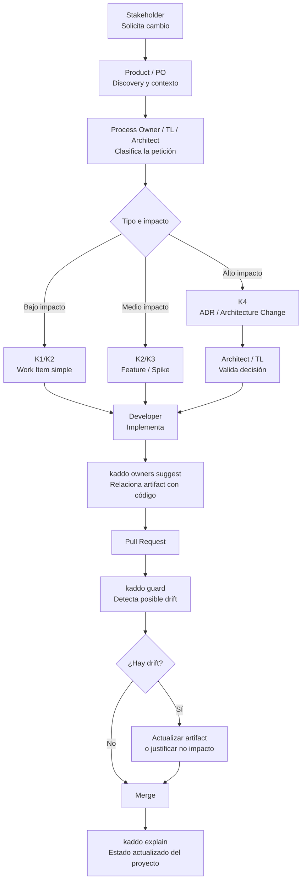

Kaddo está diseñado para mantener el conocimiento vivo **sin** convertir el desarrollo en
papeleo. El principio rector es la **gobernanza por excepción**: captura el conocimiento
mínimo requerido y añade rigor solo donde el drift realmente importa.

Esto funciona para un desarrollador solo y para un equipo grande. Ajusta las prácticas a tu
contexto — un proyecto indie puede omitir la mayoría de los roles de abajo.

## Modelo de colaboración sugerido

| Rol | Responsabilidad |
|---|---|
| **Developer** | Crea o actualiza el Work Item junto con el cambio de código. |
| **Tech Lead** | Revisa el conocimiento de alto riesgo por excepción, no cada cambio. |
| **Architect** | Revisa cambios de ADR / arquitectura. |
| **Product Owner** | Valida capacidades y supuestos del roadmap. |
| **Todo el equipo** | Trata los avisos de Guard como señales de revisión, no bloqueos. |

En un proyecto solo o indie, una persona cumple todos los roles — el valor es el mismo: un
repo que recuerda por qué existe el código.



## Reglas

- No documentes todo.
- Captura el **conocimiento mínimo requerido** para el Nivel de Conocimiento del Work Item.
- Usa los Niveles de Conocimiento para evitar burocracia.
- Declara ownership solo donde el drift importa.
- Trata los avisos de Guard como **prompts de revisión**, no como fallos.
- Usa la revisión de PR para validar conocimiento, no para castigar la falta de docs.
- Nunca aceptes output del LLM sin revisión humana.

## Responsabilidad declarada y evidencia Git

Los Work Items pueden declarar **Owners** y **Contributors** opcionales. Estos campos indican
responsabilidad o colaboración; no se infieren desde commits. Kaddo Admin permite administrarlos
en Work Items e Initiatives y muestra un resumen de Collaboration en Initiatives, Epics y Delivery
Plans.

El resumen mantiene separadas dos señales:

- **Responsabilidad declarada** — Owners y Contributors de los metadatos de Planning.
- **Actividad Git observada** — commits locales de solo lectura con una referencia exacta al Work
  Item, su autor, fecha de inspección y procedencia.

La actividad Git es evidencia para revisar, no prueba de que el trabajo terminó, de un cambio de
responsabilidad ni de productividad. El nombre de una rama solo da contexto; Kaddo nunca atribuye
un commit únicamente porque un archivo coincida con un Work Item.

En la lista de Work Items, usa **Assigned to**, **Unassigned owners**, **With linked Git activity**
y **Without linked Git activity** junto con búsqueda, estado y módulo. Git se observa solo al
elegir un filtro de actividad. Si Git no está disponible o la cobertura es parcial, Kaddo no
presenta la falta de un vínculo como prueba de que no hubo trabajo.

En multirepo, Kaddo observa cada Git root declarado una vez por consulta y lo identifica desde el
módulo declarado (o `core`); así, repositorios con la misma carpeta siguen separados. La observación
es local y acotada: máximo 100 commits, 100 ramas locales y cinco segundos por comando Git y
repositorio.

### CLI y MCP

Usa `kaddo collaboration show WI-123` para la proyección de un Work Item. MCP ofrece la misma
proyección Core mediante `kaddo_get_work_item_collaboration`,
`kaddo_get_initiative_collaboration`, `kaddo_get_epic_collaboration` y
`kaddo_get_plan_collaboration`. Estas consultas no escriben Git, no cambian lifecycle ni contactan
un proveedor Git remoto.

## Manejo de avisos de Guard

`kaddo guard` es intencionalmente **no bloqueante**. Un aviso significa: "código cambiado
coincide con un artefacto que no se actualizó — ¿es intencional?" Dos respuestas válidas:

1. **Actualiza el artefacto** — el conocimiento cambió de verdad.
2. **Déjalo intencionalmente** — el cambio no afecta al conocimiento; anótalo en el PR.

Guard nunca rompe el build por sí mismo. Plantea una pregunta para que la responda un humano.

## Checklist de PR sugerido

```txt
- ¿Este cambio tiene el Work Item correcto?
- ¿El Work Item tiene suficiente contexto para su Nivel de Conocimiento?
- Si existe ownership de código, ¿se actualizó el artefacto o se dejó sin cambios a propósito?
- ¿Guard produjo avisos?
- ¿Están documentados los supuestos?
- ¿Hay aprendizaje que preservar?
```

---

Vuelve a [Conceptos](/es/playbook/concepts/) o salta al
[Prompt Workflow](/es/playbook/prompt-workflow/).
