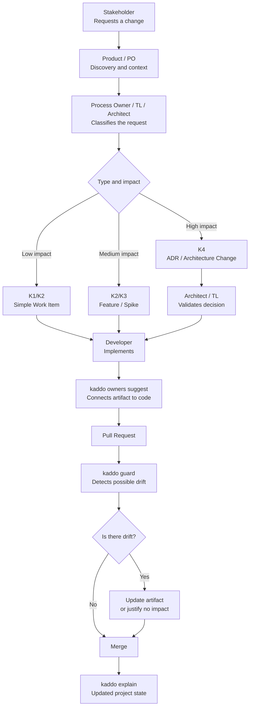

Kaddo is designed to keep knowledge alive **without** turning development into paperwork. The
guiding principle is **governance by exception**: capture the minimum knowledge required, and
add rigor only where drift actually matters.

This works for a solo developer and for a larger team. Scale the practices to your context —
an indie project may skip most of the roles below.

## Suggested collaboration model

| Role | Responsibility |
|---|---|
| **Developer** | Creates or updates the Work Item alongside the code change. |
| **Tech Lead** | Reviews high-risk knowledge by exception, not every change. |
| **Architect** | Reviews ADR / architecture changes. |
| **Product Owner** | Validates capabilities and roadmap assumptions. |
| **Whole team** | Treats Guard warnings as review signals, not blockers. |

On a solo or indie project, one person plays all roles — the value is the same: a repo that
remembers why the code exists.



## Rules

- Do not document everything.
- Capture the **minimum knowledge required** for the Work Item's Knowledge Level.
- Use Knowledge Levels to avoid bureaucracy.
- Declare ownership only where drift matters.
- Treat Guard warnings as **review prompts**, not failures.
- Use PR review to validate knowledge, not to punish missing docs.
- Never accept LLM output without human review.

## Declared responsibility and Git evidence

Work Items can declare optional **Owners** and **Contributors**. These fields state who is
responsible or contributing; they are not inferred from commits. Kaddo Admin lets you manage them
on Work Items and Initiatives, and shows a Collaboration overview on Initiatives, Epics and
Delivery Plans.

The overview keeps two signals separate:

- **Declared responsibility** — Owners and Contributors from planning metadata.
- **Observed Git activity** — local, read-only commits with an exact Work Item reference, their
  author, inspection date and Work Item provenance.

Git activity is evidence to review, not proof that work is complete, an ownership change, or a
productivity measure. A branch name is contextual only; Kaddo never attributes a commit merely
because a file overlaps a Work Item.

In the Work Items list, use **Assigned to**, **Unassigned owners**, **With linked Git activity**
and **Without linked Git activity** together with normal search, status and module filters. Git is
observed only after a Git-activity filter is selected. When Git is unavailable or coverage is
partial, Kaddo does not present a missing link as proof that no work happened.

For multirepo projects, Kaddo observes each declared Git root once per request and identifies it
from the declared module identity (or `core`), so repositories with the same folder name remain
separate. Observation is local and bounded: at most 100 commits, 100 local branches and a five
second Git command timeout per repository.

### CLI and MCP

Use `kaddo collaboration show WI-123` for a Work Item projection. MCP provides the same Core
projection through `kaddo_get_work_item_collaboration`,
`kaddo_get_initiative_collaboration`, `kaddo_get_epic_collaboration` and
`kaddo_get_plan_collaboration`. These calls do not write Git, change a lifecycle, or contact a
remote Git provider.

## Handling Guard warnings

`kaddo guard` is intentionally **non-blocking**. A warning means: "changed code matches an
artifact that was not updated — is that intentional?" Two valid answers:

1. **Update the artifact** — the knowledge genuinely changed.
2. **Leave it intentionally** — the change does not affect the knowledge; note it in the PR.

Guard never fails the build by itself. It surfaces a question for a human to answer.

## Suggested PR checklist

```txt
- Does this change have the right Work Item?
- Does the Work Item have enough context for its Knowledge Level?
- If code ownership exists, was the artifact updated or intentionally left unchanged?
- Did Guard produce warnings?
- Are assumptions documented?
- Is there learning to preserve?
```

---

Back to [Concepts](/playbook/concepts/) or jump to the
[Prompt Workflow](/playbook/prompt-workflow/).
